<div align="center">


[](https://git.io/typing-svg)

<a href="https://www.linkedin.com/in/jailsonsilvaanalista">
  
</a>
&nbsp;
<a href="https://github.com/JailsonsouzaStarCityCorp">
  
</a>
&nbsp;


</div>

---

## 🧑‍💻 Sobre mim

Sou **Analista de Suporte Pleno** e trabalho com sistemas em produção: investigo incidentes, leio logs e valido dados direto no banco para achar a causa raiz.

Hoje também **desenvolvo meu próprio aplicativo Android**, do banco de dados até o APK. Uso o olhar de suporte em cada parte: segurança, LGPD, monitoramento e o que acontece quando a internet cai.

- 🎓 Cursando **Sistemas de Informação** (Anhanguera)
- 📊 Em transição para **Análise de Dados**

---

## 🚀 Construindo agora

<div align="center">
  
</div>

| Projeto | O que é | Stack |
|---|---|---|
| 📱 **Plinplin** 🔒 | App de lives com chat, presentes animados, níveis e notificações em tempo real | 🔒 Projeto fechado |
| ✂️ **ClipJota** 🔒 | Editor de cortes para clipadores, com assinatura mensal | Python · FFmpeg · Android |
| 🎬 [**Editor Jota**](https://github.com/JailsonsouzaStarCityCorp/editor-jota-app.) | Versão aberta do editor de vídeos, nascida no Termux | Python · FFmpeg |

<sub>🔒 = repositório privado</sub>

---

## 🛠️ Stack

<div align="center">

**Apps**


**Dados**


**Cloud & Monitoramento**


</div>

---

## 📂 Projetos de dados e cloud

| Projeto | Destaque |
|---|---|
| [📈 Projeto Final BI — B3](https://github.com/JailsonsouzaStarCityCorp/Projetofinal) | Dashboard de ações em Streamlit |
| [👥 Análise de RH com SQL e Python](https://github.com/JailsonsouzaStarCityCorp/Projeto-HR---An-lise-de-RH-com-SQL-e-Python) | SQL + EDA em Python |
| [📡 Monitoramento com Zabbix](https://github.com/JailsonsouzaStarCityCorp/Monitoramento-de-API-em-Tempo-Real-Zabbix-FastAPI-Docker) | API em tempo real com FastAPI e Docker |
| [☁️ Prometheus + Grafana na AWS](https://github.com/JailsonsouzaStarCityCorp/Cloud-Monitoring-FastAPI-Prometheus-Grafana-AWS-Free-Tier-) | Observabilidade no Free Tier |
| [🛡️ Sistema Antifraude](https://github.com/JailsonsouzaStarCityCorp/Sistema-Antifraude-AWS-Neo4j-FastAPI) | Grafo de fraudes com Neo4j na AWS |

---

## 🏅 Certificações

| Certificação | Emissora | Status |
|---|---|---|
| **Oracle Cloud Infrastructure Foundations Associate** | Oracle | ✅ Certificado |
| **Oracle Data Platform 2025 Certified Foundations Associate** | Oracle | ✅ Certificado |
| **Google Ads Measurement Certification** | Google | ✅ Certificado |
| **AWS Cloud Practitioner** | Amazon Web Services | 📚 Em preparação |
| **AWS Solutions Architect Associate** | Amazon Web Services | 📚 Em preparação |

---

## 📊 Estatísticas

<div align="center">


</div>

---

## 🐍 Snake das minhas contribuições

<div align="center">

<picture>
  <source media="(prefers-color-scheme: dark)" srcset="https://raw.githubusercontent.com/JailsonsouzaStarCityCorp/jailsonsouzaStarCityCorp/output/github-snake-dark.svg" />
  
</picture>

</div>

---

## 💡 Como eu trabalho

```
🔍 Causa raiz      →  investigo antes de mexer, no suporte e no código
🔒 Segurança       →  LGPD e chaves fora do código desde o primeiro commit
📈 Medir sempre    →  logs, métricas e testes reais antes de dizer "pronto"
🚀 Entregar        →  do chamado ao deploy, sem perder o usuário de vista
```

<div align="center">


*"Cada incidente é uma oportunidade de aprender — e cada bug resolvido vira um app melhor."*

</div>
